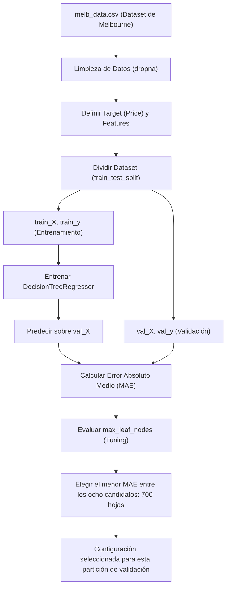

# 🤖 Aprendizaje Supervisado: Validación y Optimización de Modelos

¡Bienvenido al repositorio de **Validación y Ajuste de Modelos de Machine Learning**! Este proyecto tiene como objetivo ilustrar de forma práctica y pedagógica cómo evaluar el rendimiento de un modelo predictivo, diagnosticar problemas de **sobreajuste (overfitting)** y **subajuste (underfitting)**, y optimizar hiperparámetros utilizando un **Árbol de Decisión (`DecisionTreeRegressor`)** sobre el clásico dataset de precios de viviendas de Melbourne (`melb_data.csv`).

---

## 📋 Tabla de Contenidos
- [✨ Características Principales](#-características-principales)
- [🏗️ Estructura del Proyecto](#️-estructura-del-proyecto)
- [🔄 Flujo de Trabajo (Workflow)](#-flujo-de-trabajo-workflow)
- [⚙️ Requisitos e Instalación](#️-requisitos-e-instalación)
- [📘 Resumen de Lecciones](#-resumen-de-lecciones)
  - [Lección 1: Validación de Modelos](#lección-1-validación-de-modelos)
  - [Lección 2: Underfitting y Overfitting](#lección-2-underfitting-y-overfitting)
- [📊 Resultados Obtenidos](#-resultados-obtenidos)
- [🚀 Cómo Ejecutar](#-cómo-ejecutar)

---

## ✨ Características Principales
* **Métricas Claras:** Implementación y explicación matemática y práctica del **Error Absoluto Medio (MAE)**.
* **Validación con datos reservados:** Comparación del error "dentro de la muestra" (*in-sample*) con el obtenido en una partición de validación que no se usa para entrenar. Se utiliza una sola partición, no validación cruzada.
* **Comparación de ocho configuraciones:** Control de la complejidad del modelo ajustando `max_leaf_nodes` y selección del menor MAE de validación entre los candidatos probados.
* **Visualización de Datos:** Gráfica con `seaborn` y `matplotlib` del MAE de validación frente al máximo de nodos hoja.

---

## 🏗️ Estructura del Proyecto

```text
machine_learningCD/
├── data/
│   └── melb_data.csv       # Dataset de viviendas de Melbourne (Kaggle)
├── img/
│   ├── mae.png             # Gráfico conceptual de error vs complejidad
│   └── tree3.png           # Diagrama conceptual de divisiones de un árbol
├── 1_validacion_modelos.ipynb         # Lección 1: MAE y división de datos
├── 2_underfitting_y_overfitting.ipynb # Lección 2: Optimización de max_leaf_nodes
├── requirements.txt        # Dependencias del proyecto
└── README.md               # Documentación principal (este archivo)
```

---

## 🔄 Flujo de Trabajo (Workflow)

El siguiente diagrama de flujo ilustra el ciclo completo implementado en los cuadernos para entrenar, validar y optimizar el modelo de regresión:



---

## ⚙️ Requisitos e Instalación

Este proyecto requiere **Python 3.10+** y los paquetes listados en `requirements.txt`.

### 1. Clonar o acceder al directorio del proyecto:
```bash
cd machine_learningCD
```

### 2. Crear y activar un entorno virtual:
```bash
# En macOS/Linux
python -m venv .venv
source .venv/bin/activate
```

### 3. Instalar las dependencias necesarias:
```bash
pip install -r requirements.txt
```

> [!NOTE]
> Las dependencias principales instaladas son:
> * `scikit-learn` - Para la creación, división y evaluación del modelo.
> * `pandas` - Para manipulación y limpieza de datos estructurados.
> * `numpy` - Para operaciones numéricas eficientes.
> * `seaborn` & `matplotlib` - Para visualización de métricas y tendencias.
> * `jupyterlab` - Para la visualización y ejecución interactiva de cuadernos.

---

## 📘 Resumen de Lecciones

### Lección 1: Validación de Modelos
Esta sección aborda la pregunta fundamental: **¿Qué tan preciso es nuestro modelo con datos nuevos?**

* **Métrica MAE:** Se introduce el Error Absoluto Medio, definido formalmente como:
  $$\text{MAE} = \frac{1}{n} \sum_{i=1}^{n} |y_i - \hat{y}_i|$$
  *En términos sencillos: "En promedio, nuestras predicciones están equivocadas por X cantidad de dólares".*
* **La trampa del error "In-Sample":** El árbol ajustado y evaluado sobre las 6,196 filas completas obtiene un MAE de **434.715946**. Tras dividir los datos, el árbol ajustado sobre las 4,647 filas de entrenamiento obtiene **281.471917** en entrenamiento y **265,345.351194** en las 1,549 filas de validación. Un error de entrenamiento muy bajo no garantiza generalización.
* **Solución:** Se implementa `train_test_split(X, y, random_state=0)` para reservar un **25%** de los datos para validación y entrenar con el **75%** restante. Los estimadores también utilizan `random_state=0`.

### Lección 2: Underfitting y Overfitting
En esta lección exploramos cómo controlar la complejidad del árbol de decisión para encontrar el equilibrio perfecto.

* **Sobreajuste (Overfitting):** Ocurre cuando el árbol es demasiado profundo. El modelo memoriza el ruido y las peculiaridades del set de entrenamiento, incrementando el error en los datos de validación.
* **Subajuste (Underfitting):** Ocurre cuando el árbol es demasiado superficial (pocas hojas). El modelo no logra capturar los patrones generales y tiene un rendimiento deficiente tanto en entrenamiento como en validación.
* **Optimización (`max_leaf_nodes`):** Se crea una función iterativa `calcular_mae` para probar múltiples configuraciones de nodos (`[5, 50, 500, 600, 700, 800, 1000, 5000]`), analizando la curva de error resultante.

---

## 📊 Resultados Obtenidos

Al realizar el análisis de validación y optimización de hiperparámetros sobre la base de datos de viviendas de Melbourne con las siguientes columnas predictoras (*Features*):
* `Rooms` (Habitaciones)
* `Bathroom` (Baños)
* `Landsize` (Tamaño del terreno)
* `BuildingArea` (Área de construcción)
* `YearBuilt` (Año de construcción)
* `Lattitude` (Latitud)
* `Longtitude` (Longitud)

Se conservaron **6,196 de 13,580 filas** después de aplicar `dropna(axis=0)`. La partición reproducible contiene **4,647 filas de entrenamiento** y **1,549 de validación**. Cada `DecisionTreeRegressor(max_leaf_nodes=..., random_state=0)` se ajusta solo con entrenamiento y se compara con los precios de validación.

Se obtuvieron los siguientes valores de **MAE de validación**, expresados en las mismas unidades monetarias de `Price` y redondeados a seis decimales:

| Máximo de nodos hoja (`max_leaf_nodes`) | MAE de validación |
|--------------------------------------:|------------------:|
| 5                                     | 347,380.338333 |
| 50                                    | 258,171.212024 |
| 500                                   | 243,495.963618 |
| 600                                   | 243,951.094178 |
| **700**                               | **242,954.685712** |
| 800                                   | 244,042.742187 |
| 1,000                                 | 247,378.753656 |
| 5,000                                 | 255,575.129116 |

> [!IMPORTANT]
> **Conclusión:** **700 hojas ofrecen el menor MAE de validación entre los ocho valores probados: 242,954.685712**, frente a 243,495.963618 con 500 hojas. Este resultado corresponde al dataset, la limpieza, las siete características, los parámetros y la partición utilizados; no implica que 700 sea el valor óptimo para cualquier problema ni para cualquier partición.

Con 5 hojas el error elevado es compatible con subajuste. Con 5,000 hojas el MAE de validación aumenta respecto al mejor candidato, lo que es compatible con sobreajuste. La curva no es estrictamente monótona: deben compararse los valores calculados, sin suponer que el deterioro comienza necesariamente después de 500 hojas. `max_leaf_nodes` limita las hojas, no directamente la profundidad ni el número total de nodos.

La misma partición de validación se utiliza para seleccionar el hiperparámetro; su MAE mínimo **no es una evaluación final en un conjunto de prueba independiente**. La gráfica guardada en el segundo notebook muestra únicamente el MAE de validación, con el eje de hojas en escala logarítmica.

**Entorno de esta ejecución:** Python 3.12.14, pandas 3.1.0, NumPy 2.5.4, scikit-learn 1.9.1, Matplotlib 3.11.2 y Seaborn 0.13.2. Los notebooks contienen las salidas ejecutadas y las respuestas correspondientes.

---

## 🚀 Cómo Ejecutar

Para abrir y experimentar con los cuadernos en tu computadora local:

1. Inicia JupyterLab en tu terminal:
   ```bash
   jupyter lab
   ```
2. En la interfaz web de Jupyter, abre el archivo `1_validacion_modelos.ipynb` y ejecuta las celdas secuencialmente para observar el impacto de la separación de datos de validación.
3. Posteriormente, abre `2_underfitting_y_overfitting.ipynb` para comparar los ocho candidatos mediante la tabla y la curva del MAE de validación frente al máximo de hojas. Cada notebook puede ejecutarse desde un kernel nuevo, de forma independiente.

---
*Desarrollado como recurso de aprendizaje interactivo para fundamentos de Ciencia de Datos y Machine Learning.*
